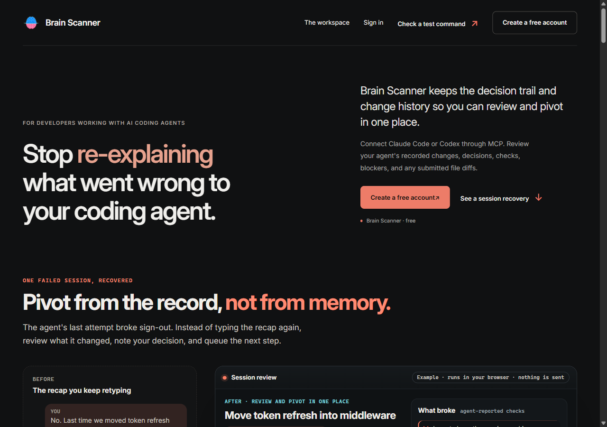
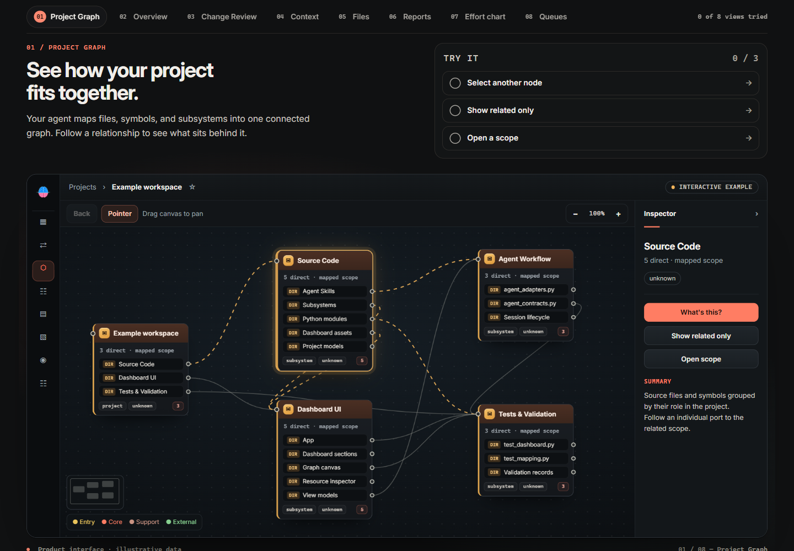

# Brain Scanner

## Stop re-explaining what went wrong to your coding agent.

Brain Scanner keeps the decision trail and change history so you can review and pivot in one place. Connect your coding agent through MCP, inspect the project, and choose what happens next.

**[Try the recovery demo](https://brainscanner.dev/#recover)** · [Create a free account](https://brainscanner.dev/signup) · [Get started](docs/getting-started.md) · [Workflow guides](https://brainscanner.dev/guides)

### A clearer next step after a failed session

An agent changes three files. Two checks fail. An earlier decision still matters. Instead of reconstructing the session from chat, review the record and give the next task a clear scope.

- **Understand the project.** Explore the map, related areas, and recorded context.
- **Review the evidence.** Read agent-submitted changes, checks, decisions, blockers, and file diffs when provided.
- **Direct the next task.** Queue work, edit its instructions, or cancel it. Return to recorded outcomes and history later.

### Try it before connecting an agent

The [homepage recovery example](https://brainscanner.dev/#recover) lets you inspect a failed session, compare its diffs and reported checks, then accept, edit, or reject a sample next step. It uses illustrative data and runs in your browser. The sample one-click decision flow is a demonstration; current projects use recorded session reviews and dashboard task controls.

The [eight-view workspace tour](https://brainscanner.dev/#workspace-demo) lets you explore Project Graph, Overview, Change Review, Context, Files, Reports, Effort, and Queues.

### Start with one project

1. [Create an account](https://brainscanner.dev/signup) and open your dashboard.
2. Use **Connect agent** to connect Claude Code or Codex through MCP.
3. Ask your agent to map one project, inspect an area, and record a useful outcome.

[First project guide](https://brainscanner.dev/guides/first-project-handoff) · [Review agent changes](https://brainscanner.dev/guides/review-agent-changes) · [Resume or hand off work](https://brainscanner.dev/guides/resume-a-coding-project)

### Follow the project

If this would help your coding workflow, **give this repository a star**. Watch releases for product updates, and [share a specific workflow or issue](docs/support.md) that would make it more useful.

[Release notes](release-notes.md) · [Recovery workflow](docs/recovery-workflow.md) · [Support](docs/support.md)

---

This is the documentation-only repository for Brain Scanner's hosted product. It contains public guides and screenshots, not the application's implementation, installers, or private project data. Use Brain Scanner at [brainscanner.dev](https://brainscanner.dev/).
